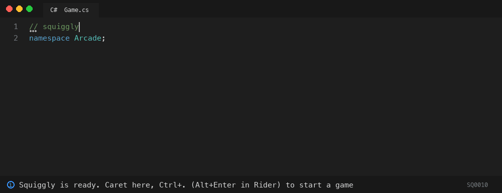

# Squiggly: play Snake in your compiler errors

Squiggly is a NuGet package that turns your IDE into a game console. Compiler diagnostics are the pixels, lightbulb code fixes are the controls, and the game state lives in a comment at the top of the file. Install it, create `Game.cs`, press <kbd>Ctrl</kbd>+<kbd>.</kbd>, and play Snake in red and yellow squiggles.



<sub>Start a game from the lightbulb, then steer by typing on the <code>// keys:</code> line. Red is the snake's head, yellow its body, and the dots are food. The animation is drawn from the real analyzer output by <a href="eng/demo">eng/demo</a>, in VS Code's dark-theme colours.</sub>

## Install

```sh
dotnet new console -n Arcade && cd Arcade
dotnet add package Squiggly
echo "// squiggly" > Game.cs
```

Open `Game.cs` in your IDE, put the caret on the first line, and press <kbd>Ctrl</kbd>+<kbd>.</kbd>. Pick **Squiggly: New game: Snake**. Then click at the end of the `// keys:` line under the board and type <kbd>w</kbd> <kbd>a</kbd> <kbd>s</kbd> <kbd>d</kbd>.

## How to play

**Steer by typing.** Snake and Tetris put a `// keys:` line under the board. Put the caret at the end of it and type: every key is one move, and the board redraws as you type. Hold a key down and the snake keeps gliding.

| Game | Keys |
|---|---|
| Snake | <kbd>w</kbd> up, <kbd>a</kbd> left, <kbd>s</kbd> down, <kbd>d</kbd> right. Pressing the way you're already going moves one step forward. |
| Tetris | <kbd>a</kbd> / <kbd>d</kbd> move, <kbd>w</kbd> rotate, <kbd>s</kbd> soft drop, <kbd>x</kbd> hard drop |

Other characters are ignored. The keys you type are your move history: the header holds where the run started, and the analyzer replays the keys on top of it. **Save progress** in the menu folds them into the header and empties the line.

**Everything else is in the lightbulb menu.** New game, Pause, Restart, Play again and the Minesweeper cells are code fixes. Put the caret on the first line (the header), or on a Minesweeper cell, and open the menu:

| IDE | Open the menu |
|---|---|
| Visual Studio 2022 | <kbd>Ctrl</kbd>+<kbd>.</kbd> |
| VS Code with C# Dev Kit | <kbd>Ctrl</kbd>+<kbd>.</kbd> (<kbd>Cmd</kbd>+<kbd>.</kbd> on macOS) |
| JetBrains Rider | <kbd>Alt</kbd>+<kbd>Enter</kbd> (<kbd>Option</kbd>+<kbd>Enter</kbd> on macOS) |

| Game | Board | Rules |
|---|---|---|
| **Snake** | 20 x 10 | Eat the food (dots), avoid the walls and yourself. Fill the board to win. The moves are also in the menu. |
| **Tetris** | 10 x 20 | Every move except hard drop also pulls the piece down one row. Dots show where the piece will land. The moves are also in the menu. |
| **Minesweeper** | 16 x 8, 16 mines | Put the caret on any dotted cell and open the menu there: Reveal or Flag. The first reveal is always safe. Minesweeper has no keys line: revealed numbers are written into the board text, which only a code fix can change. |

While playing, the header menu also offers **Pause** and **Restart**. When the game ends, it offers **Play again** and **Switch game**.

## Why?

Because the Roslyn analyzer pipeline is a perfectly good rendering engine if you squint, and lightbulbs are just buttons. Nothing here is a hack: Squiggly uses only public, supported extension points, with no IDE plugin, no reflection and no editor-specific API. That's why the same package works in Visual Studio, VS Code and Rider.

### Limitations

- **Turn-based only.** Analyzers can't run on a timer, so one key is one tick. Snake waits for you, which some people consider a feature. Holding a key comes close to real time.
- **Arrow keys can't steer.** They only move the caret, and analyzers only see text changes, so steering is done by typing letters.
- **Colours come from your theme**, not from Squiggly. See the palette below.
- **Your Error List fills up with pixels.** That is the display.
- **Error pixels fail `dotnet build`**, so a game in progress turns your build red. See [Build safety](#build-safety).

## Palette

Each colour is a diagnostic severity, and each IDE draws severities its own way. Verified so far (dark themes):

| Role | ID | Severity | VS Code (C# Dev Kit) | Rider | Visual Studio 2022 |
|---|---|---|---|---|---|
| Snake head, active piece, mines | SQ0001 | Error | red squiggle | not yet verified | not yet verified (expected red) |
| Snake body, locked blocks | SQ0002 | Warning | yellow squiggle | not yet verified | not yet verified (expected green) |
| Food, Tetris landing preview | SQ0003 | Info | grey dots | not yet verified | not yet verified (expected grey dots) |
| Minesweeper covered cell | SQ0020 | Info | grey dots | not yet verified | not yet verified |
| Minesweeper flag | SQ0021 | Warning | yellow squiggle | not yet verified | not yet verified |

## How it works

`Game.cs` starts with a one-line header such as `// squiggly v1 game=snake seed=8812 tick=37 status=playing score=4 dir=R head=10,5 tail=LL food=14,7`, followed by a canvas of `//|....|` comment lines and a `// keys:` line. A `DiagnosticAnalyzer` parses the header, replays the typed keys, renders a frame, and reports one diagnostic per lit cell, each spanning two characters of the canvas. Typing a key changes the document, so Roslyn re-runs the analyzer and the next frame appears. One more diagnostic sits on the header line, showing the score and anchoring the lightbulb menu, whose entries are `CodeFixProvider` actions that rewrite the header.

The whole game is a pure function, `Render(Replay(header, keys))`. The same file always shows the same frame on any machine, because Squiggly uses its own PRNG (SplitMix64) seeded from the header, not `System.Random`.

### The header

All state is plain text on one line, so a save game can be committed, diffed and sent as a pull request. Keys are always written in the same order:

| Keys | Meaning |
|---|---|
| `game seed tick status score` | Every game: which game, PRNG seed, moves taken, `playing`/`paused`/`over`, score |
| `dir head tail food` | Snake: direction, head cell, body as direction letters from the head (`LLD`), food cell or `-` |
| `piece rot pos next drawn lines board` | Tetris: current piece, rotation, position, next piece, pieces dealt, lines cleared, board rows as hex bitmasks |
| `mines open flags` | Minesweeper: mine layout (`-` until the first reveal), revealed cells, flagged cells, as hex row bitmasks |

The `// keys:` line under the canvas holds moves typed since the header was last written. A bare `// squiggly` means "no game yet". A header that fails to parse shows one warning (SQ9000) with a **Reset game** fix, and a damaged canvas shows one warning (SQ9001) with a **Repair canvas** fix.

## Cheating

Edit the header comment. We can't stop you. `score=9999` works fine.

## Build safety

- **Only files with a header are touched.** Squiggly checks the first five lines of each file for `// squiggly` and returns immediately if it isn't there. Your ordinary code never gets a Squiggly diagnostic.
- **Use a dedicated project.** Install Squiggly into a small "Arcade" project, not your production code. The package is a development dependency, so it never flows to anything that references your arcade.
- **Want a green build mid-game?** Lower the error severities in `.editorconfig` (your colours change with them):

  ```ini
  [*.cs]
  dotnet_diagnostic.SQ0001.severity = warning
  dotnet_diagnostic.SQ0011.severity = warning
  ```

- **`TreatWarningsAsErrors`** turns every pixel into a build error. My CI is red because I'm losing at Snake.

| ID | Severity | Meaning |
|---|---|---|
| SQ0001 | Error | Pixel, primary colour |
| SQ0002 | Warning | Pixel, secondary colour |
| SQ0003 | Info | Pixel, accent colour |
| SQ0010 | Info | HUD on the header line; also the controller |
| SQ0011 | Error | Game over; also the controller |
| SQ0020 | Info | Minesweeper covered cell; accepts Reveal and Flag |
| SQ0021 | Warning | Minesweeper flag; accepts Unflag |
| SQ9000 | Warning | Header could not be parsed |
| SQ9001 | Warning | Canvas missing or damaged |

## Benchmarks

Squiggly runs on every file in every project you install it into, so the miss path has to cost close to nothing. Measured with BenchmarkDotNet (short run) on an Apple M1 Pro, .NET 10:

| Scenario | Mean | Allocated |
|---|---:|---:|
| Early exit: look for a header in a 5,000-line ordinary file | 90 ns | 0 B |
| Read and render a 100-cell Snake | 5.3 µs | 26 KB |
| Whole analyzer through Roslyn's driver, 5,000-line ordinary file | 23 µs | 25 KB |
| Whole analyzer through Roslyn's driver, 100-cell Snake | 81 µs | 88 KB |

The two "through Roslyn" rows include the analyzer driver's own overhead. Run them yourself with `dotnet run -c Release` in `benchmarks/Squiggly.Benchmarks`.

## Contributing

```sh
dotnet build                       # everything, warnings as errors for Squiggly's own code
dotnet test                        # engine rules, golden replays, analyzer spans, code-fix behaviour
eng/pack-local.sh ~/ArcadeTest     # pack to a local feed and set up a project that uses the real package
```

`samples/Arcade` references the analyzers through project references, so you can play while developing. Rider and Visual Studio cache analyzer DLLs, so restart the IDE after rebuilding them. The engine (`src/Squiggly.Engine`) is pure and has no Roslyn dependency; game rules and their tests live there. The Roslyn layers only find lines, report diagnostics and apply edits.

## Licence

[MIT](LICENSE) © 2026 Muneeb Mughal
